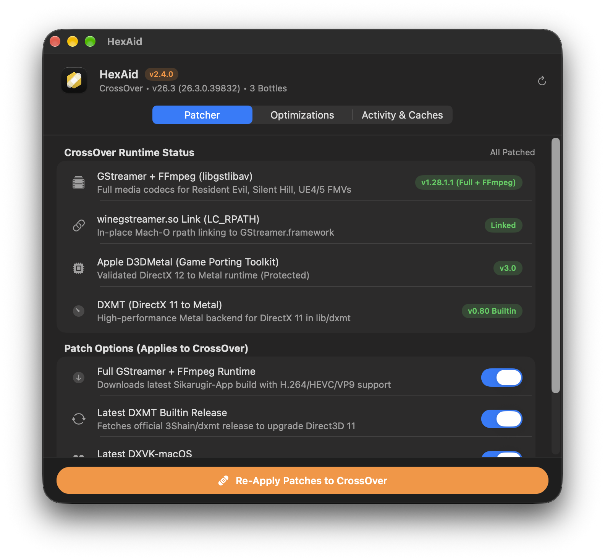

<p align="center">
  
</p>

<h1 align="center">HexAid</h1>

<p align="center">
  <strong>One-click in-place patcher for CrossOver on Apple Silicon macOS</strong><br/>
  Detects CrossOver and CrossOver Preview, upgrading GStreamer (FFmpeg), DXMT, DXVK, and bottle performance settings in-place while protecting Apple <code>D3DMetal.framework</code>.
</p>

<p align="center">
  <a href="https://github.com/passs0/HexAid/releases/latest"></a>
  
  
  <a href="LICENSE"></a>
</p>

<p align="center">
  
</p>

---

> [!NOTE]
> **AI-Generated Tool Disclosure**
> **HexAid** (including its SwiftUI source code, patching automation, and Apple Liquid Glass icon design) is an **AI-generated tool** created with **Antigravity** (Google DeepMind) and inspired by **CXPatcher** and **Procyon**.

---

## Features

- **In-Place Patching (No Duplicate App):** Patches CrossOver or CrossOver Preview directly in `/Applications` or `~/Applications`—existing bottles and games benefit immediately.
- **Full GStreamer + FFmpeg (`libgstlibav.dylib`):** Installs [`Sikarugir-App/gstreamer`](https://github.com/Sikarugir-App/gstreamer) and links `winegstreamer.so` via `install_name_tool` to fix frozen/black UE4 & UE5 cutscenes.
- **Latest DXMT & DXVK-macOS:** Fetches the latest [`3Shain/dxmt`](https://github.com/3Shain/dxmt) (D3D10/11 to Metal) and optional [`Gcenx/DXVK-macOS`](https://github.com/Gcenx/DXVK-macOS) releases.
- **Protected `D3DMetal.framework`:** Verifies CodeWeavers' validated Game Porting Toolkit framework without injecting ABI-breaking beta binaries.
- **Optimizations & Tweaks:** One-click NVIDIA RTX (`0x10DE`) D3DMetal spoofing (unlocks DLSS/MetalFX), Apple Metal Performance HUD (`MTL_HUD_ENABLED=1`), macOS Game Mode injection, `WINEMSYNC=1`, and `ROSETTA_ADVERTISE_AVX=1`.
- **Shader & Registry Maintenance:** Inspects and purges D3DMetal shader caches and GStreamer registries in one click.

## Installation

### Download Release
1. Download **`HexAid-v2.4.0.dmg`** from [GitHub Releases](https://github.com/passs0/HexAid/releases/latest) and drag **`HexAid.app`** to `/Applications`.
2. On first launch, right-click `HexAid.app` ➔ **Open**, or run `xattr -cr /Applications/HexAid.app`.

### Build from Source
```zsh
git clone https://github.com/passs0/HexAid.git && cd HexAid
./build.sh
cp -R build/HexAid.app /Applications/
```

## Credits

Inspired by [CXPatcher](https://github.com/italomandara/CXPatcher), Procyon, [3Shain/dxmt](https://github.com/3Shain/dxmt), [Sikarugir-App/gstreamer](https://github.com/Sikarugir-App/gstreamer), and [Gcenx/DXVK-macOS](https://github.com/Gcenx/DXVK-macOS).

## License

Released under the [MIT License](LICENSE).
