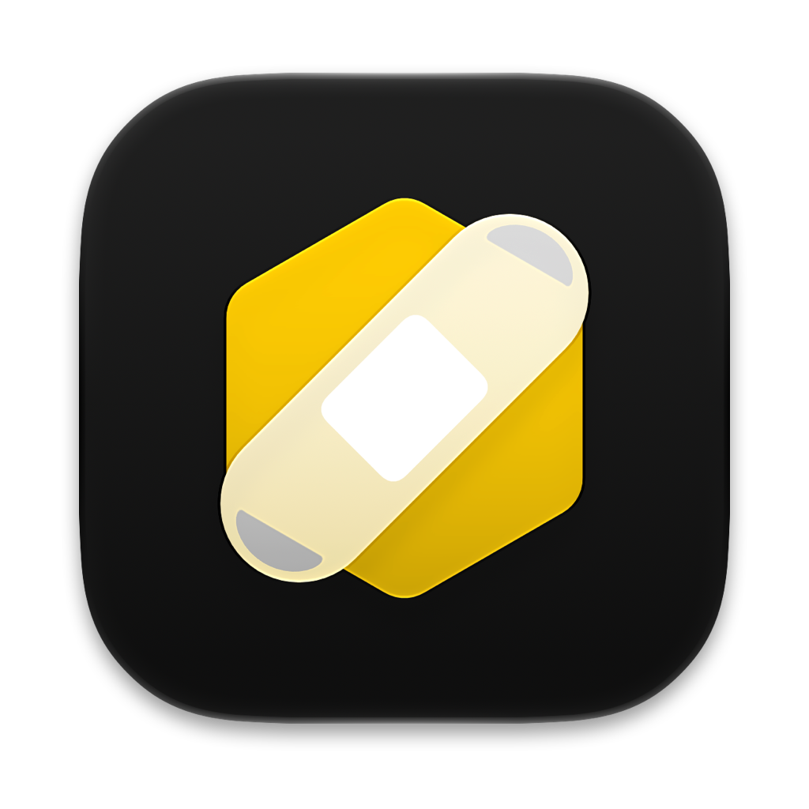

<p align="center">
  
</p>

<h1 align="center">HexAid</h1>

<p align="center">
  <strong>One-click in-place patcher for CrossOver on Apple Silicon macOS</strong><br/>
  Upgrades GStreamer (with FFmpeg / Media Foundation decoding), DXMT, DXVK, Apple Game Porting Toolkit (<code>D3DMetal.framework</code>), and bottle performance settings directly inside <code>/Applications/CrossOver.app</code>.
</p>

<p align="center">
  <a href="https://github.com/passs0/HexAid/releases/latest"></a>
  
  
  
  <a href="LICENSE"></a>
</p>

---

> [!NOTE]
> **AI-Generated Tool Disclosure**
> **HexAid** (including its SwiftUI source code, patching automation, and Apple Liquid Glass icon design) is an **AI-generated tool** created with **Antigravity** (Google DeepMind) and inspired by the open-source macOS gaming community's work on **CXPatcher** and **Procyon**.

---

## ✨ Why HexAid?

When CodeWeavers CrossOver updates (or ships out of the box), several key components are either stripped down for licensing reasons or lag behind the latest community releases:
- **Broken / Freeze-Prone In-Game Cutscenes:** Stock CrossOver omits the GStreamer `libav` (FFmpeg) plugin (`libgstlibav.dylib`), causing games like *Silent Hill 2 Remake*, *Resident Evil*, and other Unreal Engine 4/5 titles using Windows Media Foundation (`winegstreamer`) to freeze or display a black screen when playing H.264/HEVC/VP9 cutscenes.
- **Duplicate App Clutter (`Crossover_patched.app`) & Missing D3DMetal:** Earlier wrapper tools either required launching CrossOver through a secondary app or duplicated `CrossOver.app` while accidentally stripping `lib64/apple_gptk` (`D3DMetal`).

**HexAid patches `/Applications/CrossOver.app` directly in place:**
- **No duplicate `Crossover_patched.app`**—launch CrossOver normally from your Dock or Applications folder.
- **Preserves and protects Apple Game Porting Toolkit (`D3DMetal.framework`)** from accidental deletion or incompatible beta tampering.
- **Existing (Old) Bottles Automatically Benefit:** Because CrossOver bottles load their graphics backends (`D3DMetal`, `DXMT`, `DXVK`) and media libraries (`winegstreamer.so` + `GStreamer.framework`) dynamically from `/Applications/CrossOver.app` at runtime, **once you run HexAid, all of your existing (old) bottles and already-installed games immediately benefit**—no need to recreate bottles or reinstall games!

---

## 🚀 Features

1. **Full GStreamer + FFmpeg (`libgstlibav.dylib`) Upgrade**
   - Automatically fetches the latest universal `GStreamer.framework` build from [`Sikarugir-App/gstreamer`](https://github.com/Sikarugir-App/gstreamer).
   - Removes conflicting partial `libgst*` / `libglib*` libraries in `CrossOver.app/Contents/SharedSupport/CrossOver/lib64`, links `lib64/gstreamer-1.0` to `GStreamer.framework`, and adds `@loader_path/../../../lib64/GStreamer.framework/Versions/Current/lib` to `winegstreamer.so` via `install_name_tool`.
2. **Latest DXMT (Direct3D 10/11 to Metal)**
   - Automatically queries GitHub Releases for the latest [`3Shain/dxmt`](https://github.com/3Shain/dxmt) release and installs `d3d10core.dll`, `d3d11.dll`, `dxgi.dll`, and `winemetal.dll`/`winemetal.so` into `CrossOver.app`.
3. **Latest DXVK-macOS (Optional Toggle)**
   - Queries [`Gcenx/DXVK-macOS`](https://github.com/Gcenx/DXVK-macOS) and upgrades `lib/dxvk` (`x86_64-windows` and `i386-windows`).
4. **Apple Game Porting Toolkit (`D3DMetal.framework`) Integrity & Protection**
   - Verifies that CrossOver's officially validated `lib64/apple_gptk/external/D3DMetal.framework` is intact and healthy (preventing legacy wrapper bugs that stripped D3DMetal).
   - **Why standalone beta GPTK injection is intentionally avoided:** Apple's newer GPTK betas introduce tight internal ABI dependencies between `D3DMetal.framework` and Wine's PE Direct3D 12 libraries (`d3d12.dll`). Injecting unverified beta frameworks into CrossOver causes severe entry point and ABI mismatches that crash DirectX 12 games. CodeWeavers officially tests and bundles verified D3DMetal builds with CrossOver releases; HexAid safely protects this tested engine.
5. **NVIDIA RTX D3DMetal Spoofing (`0x10DE` / RTX 4090)**
   - Configures D3DMetal to report an NVIDIA GPU instead of an AMD GPU. Completely eliminates the infamous "Outdated AMD Graphics Driver" error in Unreal Engine 5 titles (*Silent Hill 2*, *Lords of the Fallen*, etc.) and unlocks in-game NVIDIA DLSS options (which map directly to native **Apple MetalFX**).
6. **Apple Metal Performance HUD Overlay (`MTL_HUD_ENABLED=1`)**
   - One-click toggle to enable or disable Apple's native Metal real-time performance HUD (FPS, frame-time graph, and GPU memory load) across all your bottles.
7. **macOS Game Mode Enabler**
   - Injects `LSApplicationCategoryType = public.app-category.games` into `CrossOver.app` and your game launchers in `~/Applications/CrossOver`, ensuring macOS `gamepolicyd` prioritizes CPU/GPU resources and boosts Bluetooth controller polling rates in full screen.
8. **Storage & Shader Cache Inspector**
   - Scans and calculates the actual disk space consumed by D3DMetal shader caches in `/var/folders` and GStreamer registries, providing one-click cache purging.
9. **Existing Bottle Performance Optimizations**
   - Scans all existing bottles in `~/Library/Application Support/CrossOver/Bottles/` and enables `WINEMSYNC=1` (MSync) and `ROSETTA_ADVERTISE_AVX=1` (AVX/AVX2 advertising under Rosetta 2) in `cxbottle.conf`.

---

## 🖥️ User Interface & Workspaces

HexAid keeps patching, bottle optimizations, and cache maintenance in three workspaces. Runtime status uses compact system-symbol rows and native group sections; cache purging asks for confirmation because the caches are rebuilt during later use. Screenshots are omitted until they can be refreshed from this release's interface.

---

## 📦 Installation

### Option 1: Direct Download (Pre-built macOS Disk Image - Recommended)
1. Download **[`HexAid-v2.3.1.dmg`](https://github.com/passs0/HexAid/releases/latest)** from [GitHub Releases](https://github.com/passs0/HexAid/releases).
2. Open the downloaded `.dmg` and drag **`HexAid.app`** directly into the **`Applications`** folder shortcut.
3. Open **`HexAid.app`** from `/Applications` and click **Patch CrossOver Now**!
   - *Note: If macOS Gatekeeper flags the binary on first launch (ad-hoc signed), right-click `HexAid.app` ➔ **Open**, or run `xattr -cr /Applications/HexAid.app`.*

### Option 2: Build from Source
HexAid has no external runtime dependencies. Build with Swift and the macOS Command Line Tools; Xcode 26.6 or later is required to compile the dynamic icon catalog. The app targets macOS 13 and later. Without `actool`, a local build uses the legacy static icon:
```zsh
git clone https://github.com/passs0/HexAid.git
cd HexAid
chmod +x build.sh
./build.sh
cp -R build/HexAid.app /Applications/
```

Whenever CrossOver updates via its built-in updater, simply open **HexAid** from `/Applications` and click **Patch CrossOver Now**.

---

## 🙏 Credits & Acknowledgments

**HexAid** is directly based on and inspired by the pioneering work of the macOS CrossOver / Wine gaming community:

- **[CXPatcher](https://github.com/italomandara/CXPatcher)** by **[@italomandara](https://github.com/italomandara)** — The original macOS patcher for CrossOver that pioneered integrating custom DXVK, DXMT, D3DMetal (GPTK), and GStreamer upgrades, as well as bottle configuration tweaks.
- **Procyon** — For demonstrating the GStreamer framework bundle layout and runtime environment ideas for fixing Windows Media Foundation (`winegstreamer`) cutscenes.
- **[3Shain/dxmt](https://github.com/3Shain/dxmt)** by **[@3Shain](https://github.com/3Shain)** — Metal-based Direct3D 10/11 implementation for Wine/CrossOver on macOS.
- **[Sikarugir-App/gstreamer](https://github.com/Sikarugir-App/gstreamer)** & **[Gcenx/DXVK-macOS](https://github.com/Gcenx/DXVK-macOS)** by **[@Gcenx](https://github.com/Gcenx)** — Prebuilt universal `GStreamer.framework` (with full FFmpeg/`libav` support) and macOS DXVK builds.
- **[CodeWeavers CrossOver](https://www.codeweavers.com/crossover)** & **Apple Game Porting Toolkit (`D3DMetal`)**.

---

## 📄 License

Released under the [MIT License](LICENSE).

See [release notes](RELEASE_NOTES.md) and the [roadmap](ROADMAP.md).
